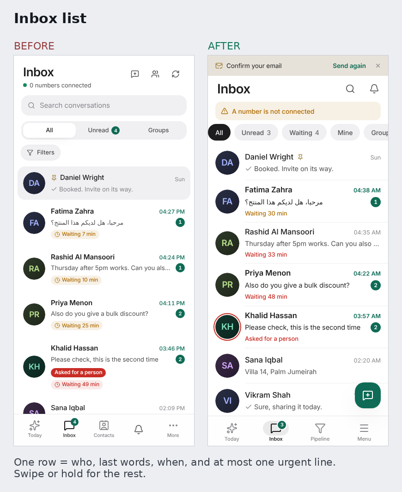

# Scriwo on a phone

The phone layout is not the desktop one made smaller. It is built on one idea: **maximum function, minimum perceived
complexity**. A person opens the app, sees the one thing that needs them, does it with one thumb, and never meets a
control before they need it.

Anything 1024 px wide or more keeps the desktop layout, exactly as it was. Every phone variant is behind a width query
(`useIsPhone`, under 1024 px; `useIsSheet`, under 640 px), so in a test without `matchMedia` everything renders as the
desktop.

## The rules, and what each means here

| Principle | On the phone |
|---|---|
| Cognitive load | One job and one main action per screen (a round green button). At most three things in a header. One urgency line per list row. No descriptions or eyebrows. |
| Progressive disclosure | Rare things live behind "⋯", a long press and "+": translate, assign, pin, private notes, import and export, labels, filters. Nothing advanced shows until it is asked for. |
| Familiarity | Chat works like WhatsApp (rows, bubbles with a tail, ticks, a back arrow with the number of other chats waiting, a "+" tray, a jump-to-latest button). Lists work like the phone's own: swipe actions, filter chips, bottom sheets. |
| Visual hierarchy | Title 28, row title 16, detail 13. Colour only means something: green is yours or the main action, red is urgent, amber is waiting, grey is everything else. |
| Habit | Four tabs that never move. Today first. A "Recent" row in the Menu. The tab bar is the same for everyone in a company. |
| Instant feedback | A pressed state on everything, a vibration tick where the browser allows it (Android), swipe trays that show a colour and a word, an Undo after Done, skeletons instead of spinners. |
| Control | Back always closes the top thing: a sheet first, then the chat. Every sheet also closes by pulling it down or tapping outside. Nothing navigates by surprise. |
| Few decisions | Riwo offers "write a reply" on the send button only when nothing is typed and a customer is waiting. |

## Screen by screen

- **Tab bar.** Today, Inbox, one more, Menu. The "one more" is chosen once per company: its industry solution if it has one
  (Real estate), else the pipeline if the plan includes it, else Contacts. It steps away while a chat is open or a field is
  being typed in, and shares its height as `--tabbar-h` so the round button and the toasts sit above it.
- **Menu.** Search first, then the places visited last, then Work and Company as a list (locked items marked), and the
  account behind one row. The bell lives in the headers of Today and Inbox.
- **Inbox.** Rows are 76 px: picture (a red ring when a person was asked for), name, time, a one-line preview with ticks,
  an unread badge and at most one coloured line ("Asked for a person", "Waiting 49 min", red once past the reply target).
  Pull a row right for *Mine* and *Read*, left for *Done* and *More*; a full swipe does the first. Hold a row for the full
  menu. One row of chips (All, Unread, Waiting, Mine, Groups, Filters); the rest of the filters are in a sheet that says
  "Show N chats". Pull the list down to refresh.
- **Chat.** Back (with the other unread count), the name (opens the details sheet) and one "⋯". One slim line for the
  pipeline: stage (opens a list), value, a red icon if a follow-up is late. Hold a message for Reply, Copy, Translate,
  Delete. The composer is one row: "+", a box that grows, and send. A private note turns the box yellow and says so.
- **Today.** A greeting, one line, search and alerts, then the first three things; "Show N more" for the rest.
- **Pipeline.** Totals in a line, search with a Filters button (a sheet), a list of steps for "Move to", a round button for
  a new lead. **Contacts.** A plain list; tap for Message, Add to pipeline, Edit, Delete (which still asks); hold to choose
  several; import, export and labels behind "⋯"; a round button for a new contact. **Automations.** The company's own rules
  first, the ideas after. **Broadcasts.** A round button once there are broadcasts.
- **Installable.** `public/manifest.webmanifest`, icons and the `apple-mobile-web-app-*` metas. There is no service worker.

## The touch kit

Everything is under `src/components/mobile/`, `src/hooks/` and `src/utils/haptics.ts`, with no extra dependencies.

| Piece | What it does |
|---|---|
| `SheetShell`, `Sheet` (`ui/Sheet.tsx`) | Bottom sheet on a phone, dialog elsewhere. Pull down (far enough, or a quick flick) to close, Back closes it, the page behind stays still, it keeps clear of the keyboard. Every dialog in the app uses it. |
| `ActionSheet` | A short list of actions with one destructive style. Used by every "⋯" and every long press. |
| `Swipeable` | A row with action trays. Vertical movement is left to the page. Opens at 40% of the trays, does the first action at about half the row, one row open at a time. |
| `useLongPress` | 450 ms, cancelled by movement, plus the context-menu gesture for Android and keyboards. |
| `usePullToRefresh`, `PullIndicator` | Pull a scroller down from its top. |
| `Toasts` | One message at a time, with Undo. Does nothing without a provider. |
| `Fab` | The round main button, drawn on the page (not inside the screen) and kept above the tab bar. |
| `useBackClose` | Back closes the top overlay instead of leaving the app; a hand-over from one overlay to the next is queued so two never cross. |
| `useTyping`, `useViewportHeight` | Whether the keyboard is up; the visible height as `--vvh`. |
| `PageHeader` `phone` prop | A 48 px title with one main action and a "⋯"; without it, a screen's actions scroll sideways in one row. |
| Global CSS (`index.css`) | 16 px fields on touch screens (iOS stops zooming), a 44 px tap target for every small control (an invisible box that grows only as far as needed; `.hit-none` turns it off for big rows), press states. |

## Adding or changing a phone screen

1. Gate the variant with `useIsPhone()`. Leave the desktop markup as it is.
2. Give the screen one main action. Put the rest behind "⋯", a hold, or a sheet. Use `PageHeader`'s `phone` prop and `Fab`.
3. Anything tappable is at least 44 px (small controls get that for free); fields are at least 16 px.
4. Back must close what the person opened: use `Sheet`/`ActionSheet`, or `useBackClose` for a screen-sized thing.
5. A destructive action is never one swipe: it is a menu, then a confirmation (Done has an Undo instead, because it can be undone).
6. Test it with a mocked `matchMedia` (see `phone_screens.test.tsx`), then run `scripts/phone-audit.mjs`.

## How it was checked

- **Unit tests** (`phone_touch`, `phone_shell`, `inbox_phone`, `phone_screens`): back stack, swipe thresholds, long press, sheet
  drag, tab choice per plan and solution, headers, rows, menus, composer, filters. Each behaviour was broken on purpose once
  to confirm a test fails.
- **Real browser, touch input** (Chromium with touch emulation and raw touch events): sheet drag and flick, Back closing a
  sheet and then the chat, the tab bar stepping away, swipes with Undo, holding a row, pull to refresh, the jump button, the
  keyboard (visible height shrunk), dark theme and reduced motion.
- **`scripts/phone-audit.mjs`** walks 16 screens and sheets at 320, 360, 375, 390 and 430 px and reports sideways scrolling,
  targets under 44 px, fields under 16 px and unnamed buttons. On 4 November 2026 it found none. Before the touch rules it
  found 47 targets under 44 px.
- **First-run screens** (the welcome guide and Today for a company with no number, which the audit script skips past): on
  8 November 2026 they were checked at 320x568, 360x640, 375x667, 390x844 and 430x932 with the same measurements. The guide's Skip
  was out of reach at 320x568; fixed (see below). Everything else was clean.
- **Pictures**: `docs/mobile/before-after-*.png`, the same seeded company before and after.

## Things that went wrong once (so nobody learns them again)

- A long press opens a menu under the finger; lifting the finger sends a click to whatever is there now. Sheets ignore a click
  that belongs to a press which began before they opened.
- Flick speed is measured with the events' own timestamps. Measured when the page gets round to them, a busy page turned a
  flick into a slow drag.
- A sheet stays mounted while shut, so what a drag left behind (pulled off the screen) must be cleared on close.
- A focused field that is removed from the page (the sign-in form) never says it lost focus; `useTyping` watches for it, or the
  tab bar stayed hidden after signing in.
- An Undo must say what it wants ("open again"), not "flip": a flip applied to a list that had not caught up yet did nothing.
- `button::after` is used for the tap target, so a button cannot use `::after` for anything else.
- The first-run guide's Skip button was under the chat bubble on a phone.
- A dialog that scrolls as a whole lets the autofocus on its main button scroll everything else out of sight: when the guide
  got a second big button it was taller than a 320x568 screen and Skip ended up 120 px above the top. Pin the header and the
  buttons and let only the middle scroll.
- `tsc --noEmit -p .` checks nothing here (the root config has `files: []`); use `tsc -b`, which is what the build runs.

## Not included

Web push notifications (they need a service worker and server keys: the biggest habit builder, and its own piece of work),
offline use, voice notes, native app wrappers. The website does not claim them.
